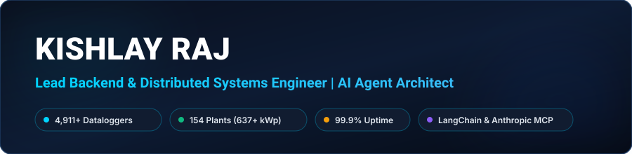

<!-- LOCAL REPO HEADER BANNER (100% RELIABLE, ZERO PROXY BREAKS) -->

  

<!-- DYNAMIC TYPING SVG -->

  

<!-- SOCIAL & CONTACT BADGES -->

  
  &nbsp;
  
  &nbsp;
  
  &nbsp;
  
  &nbsp;
  

---

## 👨‍💻 Executive Summary

High-impact **Lead Backend & Distributed Systems Engineer** and **AI Agent Architect** with **4+ years of production experience** architecting mission-critical IoT telemetry backends, high-concurrency event-driven architectures, and autonomous multi-agent AI ecosystems.

- ☀️ **Current Scale:** Spearheading end-to-end backend operations for **3,000+ live solar dataloggers** across **12+ MW operational generation capacity** with **99.9% production uptime**.
- ⚡ **High Throughput:** Operating an enterprise **Mosquitto MQTT broker cluster** handling **100,000+ daily packets** with sustained peak throughput exceeding **1,700 messages/second** with zero dropped packets.
- 🗄️ **Time-Series Optimization:** Designed partitioned **TimescaleDB hypertables** with compound indexing and automated chunk retention, achieving a **95% query latency reduction** across **100M+ historical telemetry records**.
- 🤖 **Agentic AI Leadership:** Pioneer in production Agentic AI systems deploying **CHAMP OS** using **LangChain, LangGraph**, and **Anthropic Model Context Protocol (MCP)** for automated telemetry anomaly triage and self-healing cloud pipelines.
- 📍 **Location:** Greater Noida, Uttar Pradesh, India

---

## 🛠️ Core Technical Competencies

| Domain | Technologies, Frameworks & Tooling |
| :--- | :--- |
| **Backend & Core Languages** | `Python (Advanced)` `Django` `Django REST Framework` `FastAPI` `Java` `JavaScript` `Bash Scripting` |
| **AI Agents & LLM Systems** | `Anthropic Model Context Protocol (MCP)` `LangChain` `LangGraph` `Autonomous Agent Loops` `Multi-Agent Tool Calling` `RAG Pipelines` `Llama 3.3` |
| **Distributed Systems & IoT** | `MQTT (Mosquitto TLS/mTLS)` `Modbus RTU/TCP` `WebSockets` `Redis Pub/Sub` `Celery Task Queues` `Event-Driven Systems` |
| **Databases & Time-Series** | `TimescaleDB (Hypertables & Chunking)` `PostgreSQL` `PgBouncer` `Redis Caching` `MySQL` `Query Optimization` |
| **Cloud & Infrastructure** | `AWS (EC2, VPC, EBS, Security Groups, IAM)` `Linux Administration (Ubuntu)` `Nginx Reverse Proxy` `Gunicorn` `SSL/TLS Automation` `Docker` |
| **Architecture & DevOps** | `High-Throughput Ingestion Pipelines` `Multi-Tenant RBAC` `Microservices` `CI/CD` `GitOps` `Zero-Downtime Deployment` |

 

<!-- SKILL ICONS -->

  

---

## 💼 Professional Experience

### 🚀 **Lead Backend & Cloud Systems Engineer** | *Watthut Electronics / Involtics India LLP*
*Jan 2025 – Present | Greater Noida, India*
- Architected and operate centralized clean-tech IoT telemetry platform managing **3,000+ commercial & residential dataloggers** across **12+ MW operational solar generation** with **99.9% production uptime**.
- Engineered autonomous multi-agent AI operating systems (**CHAMP OS**) utilizing **LangChain** and **Anthropic Model Context Protocol (MCP)** for automated telemetry anomaly triage, device health verification, and high-velocity cloud orchestration.
- Engineered enterprise **Mosquitto MQTT broker cluster** featuring mutual TLS authentication (mTLS), handling **100,000+ daily packets** with sustained peak throughput exceeding **1,700 messages/second** with zero dropped packets.
- Designed partitioned **TimescaleDB hypertables** with compound indexing and automated chunk retention, achieving a **95% reduction** in dashboard query response time across **100M+ historical telemetry rows**.
- Spearheaded reverse-engineering and full localization of the global **Deye Solar cloud platform** to comply with India data sovereignty standards, successfully powering 3 high-availability production domains.
- Built distributed **Celery and Redis** worker task pipelines for real-time solar inverter fault alerts, energy rollups, and automated customer diagnostics.
- Automated multi-server deployment workflows across **7 AWS production EC2 servers** using Nginx, Gunicorn, SSL auto-rotation, and automated disaster-recovery backup schedules.

---

### ⚙️ **Software Developer (Backend & IoT)** | *LongLasst Smart Appliances*
*Jun 2024 – Dec 2024 | Gurugram, India*
- Developed high-performance RESTful APIs using **Django REST Framework** for real-time sensor ingestion across thousands of smart consumer appliances.
- Integrated **Redis Pub/Sub** and **WebSocket** bidirectional streaming, providing sub-100ms live appliance diagnostics to web and mobile client dashboards.
- Designed normalized **PostgreSQL** schemas and optimized queries for appliance telemetry logging, automated warranty validation, and multi-tenant user access.

---

### 🌐 **Software Engineer** | *GLOBAIoT*
*Mar 2023 – May 2024 | Faridabad, India*
- Engineered resilient industrial IoT data ingestion pipelines with automated failover and retry mechanics for multi-sensor environmental monitoring arrays.
- Tuned **PostgreSQL** analytical queries and indexing strategies, decreasing query latency by **40%** over multi-million row historical sensor databases.
- Created automated **Python CLI toolsets** for remote device provisioning, edge heartbeat monitoring, and automated hardware diagnostics.

---

### 📡 **Software Engineer (Backend & IoT)** | *Pinglaksh Anveshnam Pvt. Ltd.*
*Feb 2022 – Feb 2023 | Gurugram, India*
- Designed and implemented REST APIs using **Django** to parse binary sensor telemetry from edge dataloggers and feed real-time analytics monitoring dashboards.
- Configured **MQTT brokers** and **Modbus RTU/TCP register maps** to interface hardware controllers with cloud data stores over cellular connectivity.
- Promoted from Software Developer Intern (Aug 2021 – Feb 2022) after leading development of backend ingestion modules and Linux server configurations.

---

## 🎓 Education & 📜 Certifications

- **Bachelor of Technology (B.Tech) in Computer Science & Engineering** | *Kurukshetra University* (2017 – 2021)
- 🏅 **Microsoft Applied Skills:** AI Agent Development *(Credly Verified Badge)*
- 🏅 **Anthropic Model Context Protocol (MCP) & LangChain Architecture**
- 🏅 **Python Programming & Distributed Systems Specialization**
- 🏅 **Core & Advanced Java Enterprise Systems**

---

## 📊 Engineering Telemetry & Activity

  
  

  

 

<!-- PROFILE VIEWS COUNTER -->

  

  <i>"Architecture is not just about what works; it is about building systems that never fail under production scale."</i>

