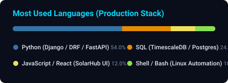

<div align="center">

<!-- LOCAL REPO HEADER BANNER (100% RELIABLE, ZERO PROXY BREAKS) -->


<br/><br/>

<!-- DYNAMIC TYPING SVG -->
<a href="https://git.io/typing-svg">
  
</a>

<br/><br/>

<!-- SOCIAL & CONTACT BADGES -->
<p align="center">
  <a href="https://www.linkedin.com/in/kishlay-raj-409853154/" target="_blank">
    
  </a>
  &nbsp;
  <a href="mailto:rajkishlay786@gmail.com">
    
  </a>
  &nbsp;
  <a href="https://github.com/Rajkishlay1" target="_blank">
    
  </a>
  &nbsp;
  <a href="https://gitlab.com/rajkishlay786" target="_blank">
    
  </a>
  &nbsp;
  <a href="tel:+918271054558">
    
  </a>
</p>

</div>

---

## 👨‍💻 Executive Summary

High-impact **Lead Backend & Distributed Systems Engineer** with **4+ years of production experience** architecting mission-critical IoT telemetry backends, high-concurrency event-driven architectures, and distributed renewable energy monitoring platforms.

- ☀️ **Production Fleet Scale (Verified Live):** Direct architecture owner of Involtics SolarHub platform managing **637.99 kWp installed solar capacity** across **154 commercial and residential plants**, **4,911+ live dataloggers**, and **121+ industrial inverters** with **99.9% uptime**.
- ⚡ **High-Throughput Telemetry Pipeline:** Operating clustered **Mosquitto MQTT brokers** (TLS/mTLS) ingesting **100,000+ daily packets** (~2-minute telemetry intervals) with peak bursts exceeding **1,700 messages/sec** and zero message loss.
- 🗄️ **Time-Series Optimization:** Architected partitioned **TimescaleDB hypertables** with automated chunk compression and compound indexing, slashing dashboard analytical query latency by **95%** across **100M+ historical telemetry records**.
- 🔄 **Enterprise Protocols & Remote Control:** Implemented bidirectional inverter telemetry and parameter control supporting **GB3024 ASCII CRC-16 protocol** and **Deye Modbus RTU V133 protocol** for active/reactive power regulation, work modes, and smart meter integration.
- 🌐 **OpenAPI & Third-Party Integration:** Built secure **NBI (Open Platform)** microservice with `X-App-Id` and `X-App-Secret` tokenization for third-party developer telemetry access with customer-level plant isolation.
- 🤖 **Agentic AI Leadership:** Pioneer in production Agentic AI systems deploying **CHAMP OS** using **LangChain, LangGraph**, and **Anthropic Model Context Protocol (MCP)** for automated telemetry anomaly triage and self-healing cloud pipelines.
- 📍 **Location:** Greater Noida, Uttar Pradesh, India

---

## 🌐 Production Cloud Topology & System Architecture

Distributed multi-server high-availability ecosystem running across dedicated AWS production infrastructure:

```
                                  ┌───────────────────────────────┐
                                  │   DNS & Global Edge Gateway   │
                                  └───────────────┬───────────────┘
                                                  │
                 ┌────────────────────────────────┼────────────────────────────────┐
                 ▼                                ▼                                ▼
  ┌──────────────────────────────┐ ┌──────────────────────────────┐ ┌──────────────────────────────┐
  │     Corporate Edge Web       │ │    Core Relational & RMS     │ │   Telemetry Engine (Inventa) │
  ├──────────────────────────────┤ ├──────────────────────────────┤ ├──────────────────────────────┤
  │ • watthut.com                │ │ • ramsdb.involtics.com       │ │ • dbdemo.involtics.com       │
  │ • involtics.com              │ │ • rmsindapp.involtics.com    │ │ • String Inverter & 3kW 1-Ph │
  │ • Corporate Portal & Brand   │ │ • rmsapp.involtics.com       │ │ • MQTT Broker & TimescaleDB  │
  │ • Edge Nginx & SSL Router    │ │ • India Data Center Core App │ │ • NBI OpenAPI Customer API   │
  └──────────────────────────────┘ └──────────────────────────────┘ └──────────────┬───────────────┘
                                                                                   │ API / WS
                                                                                   ▼
                                                                    ┌──────────────────────────────┐
                                                                    │   SolarHub Client Portal     │
                                                                    ├──────────────────────────────┤
                                                                    │ • solarhub.involtics.com     │
                                                                    │ • 150 Plants & 623.19 kWp UI │
                                                                    │ • Real-time React Dashboard  │
                                                                    │ • Live Energy Flow & Alarms  │
                                                                    └──────────────────────────────┘
```

| Server Role | Production Domains / Services | Architecture & Tech Stack |
| :--- | :--- | :--- |
| **Edge Web & Corporate** | `watthut.com`<br/>`involtics.com` | High-availability Nginx edge proxy, SSL auto-rotation, corporate web applications |
| **Global & India RMS** | `ramsdb.involtics.com`<br/>`rmsindapp.involtics.com`<br/>`rmsapp.involtics.com` | Primary relational database cluster, India Data Center RMS application, Global App backend |
| **Telemetry & Ingestion Engine** | `dbdemo.involtics.com` | Python/Django 5, Gunicorn, Mosquitto MQTT, TimescaleDB Hypertables, Celery/Redis, NBI OpenAPI |
| **SolarHub Dashboard** | `solarhub.involtics.com` | Production Solar Management Dashboard (150 Plants, 623.19 kWp), Real-time Flow Visualizations |

---

## 🛠️ Core Technical Competencies

<div align="center">

| Domain | Technologies, Frameworks & Tooling |
| :--- | :--- |
| **Backend & Core Languages** | `Python (Advanced)` `Django 5` `Django REST Framework` `FastAPI` `Java` `JavaScript` `Bash Scripting` |
| **Distributed Systems & IoT** | `MQTT (Mosquitto TLS/mTLS)` `Modbus RTU/TCP` `GB3024 ASCII` `WebSockets` `Redis Pub/Sub` `Celery Task Queues` |
| **Databases & Time-Series** | `TimescaleDB (Hypertables & Compression)` `PostgreSQL` `PgBouncer` `Redis Caching` `MySQL` `SQL Tuning` |
| **AI Agents & LLM Systems** | `Anthropic Model Context Protocol (MCP)` `LangChain` `LangGraph` `Autonomous Agent Loops` `Multi-Agent Tool Calling` |
| **Cloud & DevOps** | `AWS (EC2, VPC, EBS, Security Groups, IAM)` `Linux Administration (Ubuntu)` `Nginx Reverse Proxy` `Gunicorn` `Docker` |
| **Multi-Cloud Governance** | `Dual-Remote Mirroring (GitHub + GitLab)` `Automated Multi-Server Daily Backups` `Zero-Downtime Deployment` |

<br/>

<!-- SKILL ICONS -->
<p align="center">
  
</p>

</div>

---

## 💼 Professional Experience

### 🚀 **Lead Backend & Cloud Systems Engineer** | *Watthut Electronics / Involtics India LLP*
*Jan 2025 – Present | Greater Noida, India*
- Direct end-to-end architecture ownership of centralized solar IoT platform managing **637.99 kWp installed solar capacity** across **154 commercial and residential plants**, **4,911+ live dataloggers**, and **121+ industrial inverters** with **99.9% uptime**.
- Architected enterprise **Mosquitto MQTT ingestion engine** handling **100,000+ daily packets** (~2-minute telemetry intervals) with peak bursts exceeding **1,700 msgs/sec** and zero packet drops.
- Designed partitioned **TimescaleDB hypertables** with automated chunk retention and compression, slashing analytical dashboard query latency by **95%** across **100M+ rows**.
- Implemented full-duplex remote inverter parameter control using **GB3024 ASCII CRC-16** and **Deye Modbus RTU V133**, enabling remote grid-tied/zero-export limits and work-mode switching.
- Built secure **NBI (Open Platform)** microservice featuring `X-App-Id` and `X-App-Secret` tokenization, enabling enterprise customers to pull real-time telemetry securely with plant-level isolation.
- Implemented **Dual-Push Multi-Cloud Git Governance** across GitHub and GitLab with automated branch mirroring and strict organizational repository boundaries.
- Engineered automated daily backup architecture running server-side cron (`involtics_db`, backend codebase, and frontend build) with automated local disaster-recovery mirroring.

---

### ⚙️ **Software Developer (Backend & IoT)** | *LongLasst Smart Appliances*
*Jun 2024 – Dec 2024 | Gurugram, India*
- Developed high-performance RESTful APIs using **Django REST Framework** for real-time sensor ingestion across thousands of smart consumer appliances.
- Integrated **Redis Pub/Sub** and **WebSocket** bidirectional streaming, providing sub-100ms live appliance diagnostics to web and mobile client dashboards.
- Designed normalized **PostgreSQL** schemas and optimized queries for appliance telemetry logging, automated warranty validation, and multi-tenant user access.

---

### 🌐 **Software Engineer** | *GLOBAIoT*
*Mar 2023 – May 2024 | Faridabad, India*
- Engineered resilient industrial IoT data ingestion pipelines with automated failover and retry mechanics for multi-sensor environmental monitoring arrays.
- Tuned **PostgreSQL** analytical queries and indexing strategies, decreasing query latency by **40%** over multi-million row historical sensor databases.
- Created automated **Python CLI toolsets** for remote device provisioning, edge heartbeat monitoring, and automated hardware diagnostics.

---

### 📡 **Software Engineer (Backend & IoT)** | *Pinglaksh Anveshnam Pvt. Ltd.*
*Feb 2022 – Feb 2023 | Gurugram, India*
- Designed and implemented REST APIs using **Django** to parse binary sensor telemetry from edge dataloggers and feed real-time analytics monitoring dashboards.
- Configured **MQTT brokers** and **Modbus RTU/TCP register maps** to interface hardware controllers with cloud data stores over cellular connectivity.
- Promoted from Software Developer Intern (Aug 2021 – Feb 2022) after leading development of backend ingestion modules and Linux server configurations.

---

## 🎓 Education & 📜 Certifications

- **Bachelor of Technology (B.Tech) in Computer Science & Engineering** | *Kurukshetra University* (2017 – 2021)
- 🏅 **Microsoft Applied Skills:** AI Agent Development *(Credly Verified)*
- 🏅 **Anthropic Model Context Protocol (MCP) & LangChain Architecture**
- 🏅 **Python Programming & Distributed Systems Specialization**
- 🏅 **Core & Advanced Java Enterprise Systems**

---

## 📊 Engineering Telemetry & Activity

<div align="center">

<p align="center">
  
  
</p>

<p align="center">
  
</p>

<br/>

<!-- PROFILE VIEWS COUNTER -->


<br/><br/>

<p align="center">
  <i>"Architecture is not just about what works; it is about building systems that never fail under production scale."</i>
</p>

</div>
